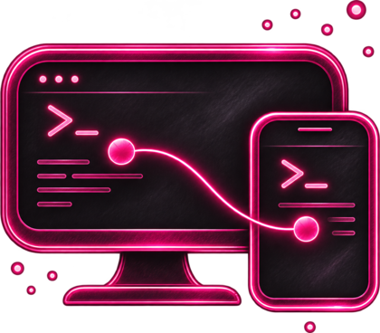
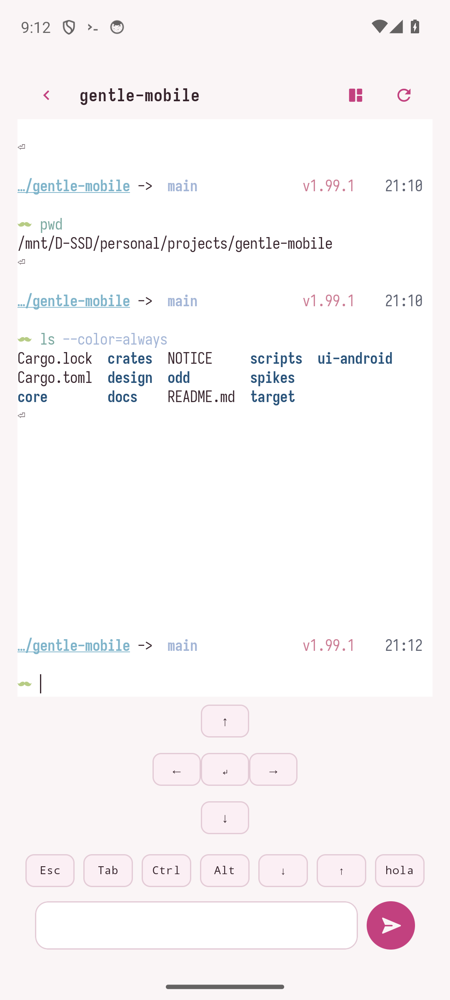
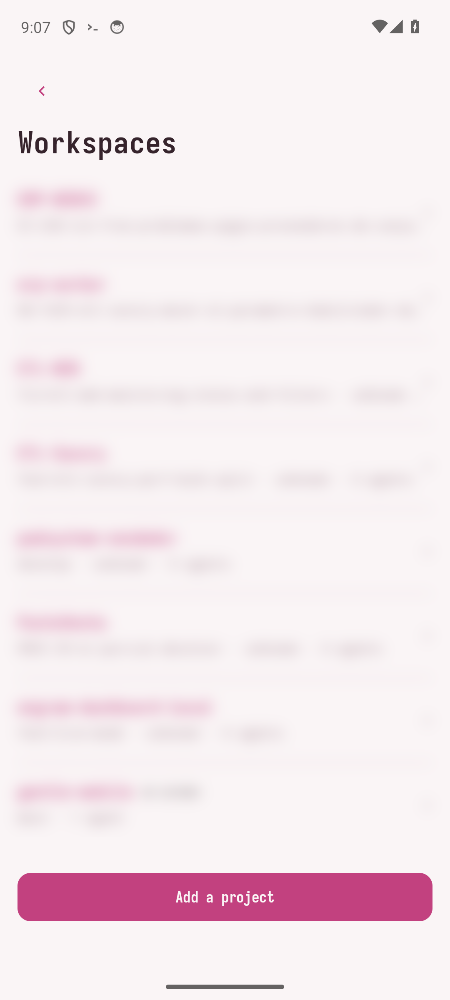
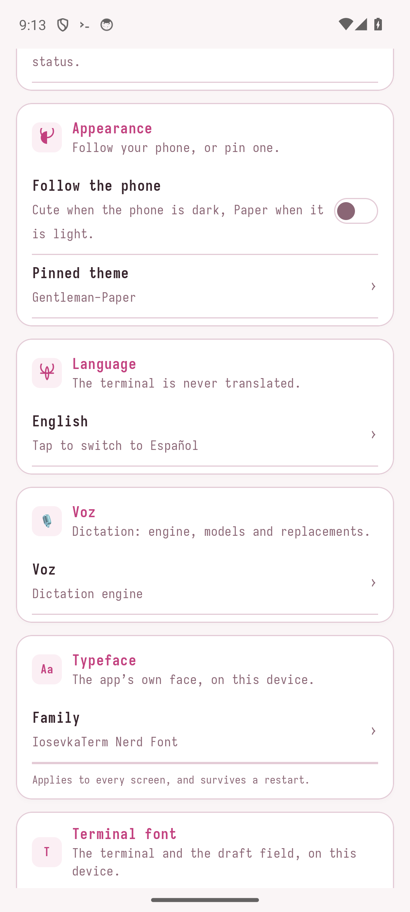

<p align="center">
  
</p>

<h1 align="center">Gentle Mobile</h1>

<p align="center">Your coding agents, on your phone — a real terminal over SSH to your own machine.</p>

<p align="center">
  
  
  
</p>

Gentle Mobile is a native Android app (Kotlin/Compose over a Rust core) that connects to
[herdr](https://herdr.dev) on your computer and gives you a **terminal sized to the phone**, with your
own colours, the tabs and panes of your workspaces, and the agent board that tells you who needs you.

No relay, no account, no server in between: the phone talks SSH to your machine.

## What it does

- **A real terminal.** The app opens its own PTY at the phone's size, so text is large and nothing is
  cropped. Your login shell starts in the workspace folder.
- **Your themes.** Four (Cute, Paper, Sexy, Gentle) drive the whole app *and* the terminal palette; Paper
  is a real light terminal, not a black block.
- **Four terminal faces**, all monospaced with Nerd glyphs: IosevkaTerm, JetBrainsMono, FiraCode, Hack.
- **A key pad you configure**: which keys show, in what order, and what each does — a key, `Ctrl+C`, or
  text with optional Enter. The joystick is its own toggle.
- **Workspaces, tabs and panes** of the host; create or close a tab from the phone.
- **The agent board**: who needs you, the exact command before approving, one-tap answers, and risky ones
  held behind a confirmation.
- **Pairing in one scan**, a device key generated on the phone, and host keys pinned on first use.

## Configure it (PC ↔ phone)

**On the computer** — needs `sshd`, and `herdr` running:

```sh
# from the repository
./scripts/gentle-mobile pair
```

It prints a QR and a one-line link, and waits for one phone. Nothing else to install.

**On the phone:**

1. Install the APK (`gentle-mobile-<version>.apk`, signed; sideload it once).
2. Open the app → **Add a host**.
3. **Scan the QR** (or paste the `gc://` link under *Manual setup*), accept the host fingerprint once.
4. Tap the host → pick a workspace → the terminal opens in that folder.

The phone's key is generated on the device and never leaves it; a host whose key changes is refused.
Tailscale, a LAN or any VPN that reaches `sshd` works — the app does not care how the network is built.

The CLI also has `gentle-mobile status` (is this phone's key trusted here), `gentle-mobile revoke` (remove
it), and `Settings → Hooks` shows the same steps with a copy button and the live status.

## Build it

```sh
. scripts/android-env.sh            # JDK, SDK/NDK, rustup targets
scripts/build-core-android.sh       # the Rust core and its bindings
cd ui-android && ./gradlew :app:assembleDebug
```

317 tests in the Rust core and 490 in the JVM suite pin the behaviour; screens are verified by looking at
them, not by the tests alone.

## Known limits

- Android 10+; iOS is not published (no Apple account here).
- The terminal is a VT subset: no alternative screen yet, so full-screen `vim`/`less` are out.
- An agent started **inside the app's terminal** is invisible to herdr, so approvals there are text and
  keys — the board only sees agents running in herdr's own panes.
- Local dictation models are downloaded by the user, never bundled.

## Licence and credits

Apache-2.0. The Rust core derives from Bellterm's, with herdr's vendored crates under their own terms —
see [`NOTICE`](NOTICE). Icons: [Iconoir](https://iconoir.com). Typefaces: Space Grotesk, IBM Plex Sans,
Aldrich, IosevkaTerm, JetBrainsMono, FiraCode and Hack, all under the SIL Open Font License, some of them
subsetted with [Nerd Fonts](https://www.nerdfonts.com) patches.
